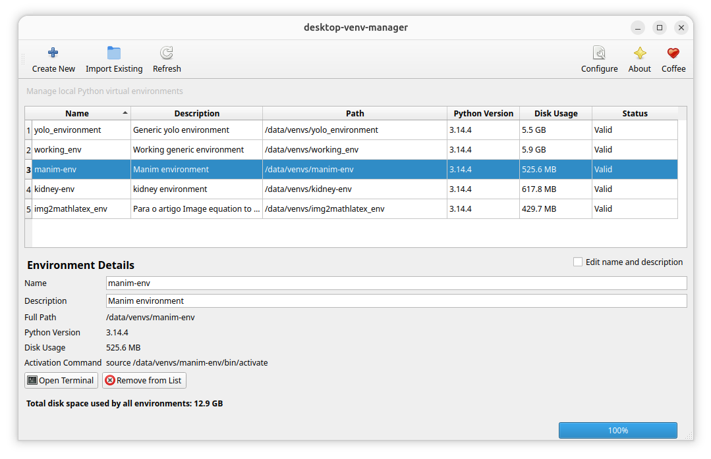

# desktop-venv-manager

A local Linux desktop application for creating, importing, inspecting, and managing Python `venv` environments.



## 1. Installing

To install the package from [PyPI](https://pypi.org/project/desktop_venv_manager/), follow the instructions below:

### With pip

```bash
pip install --upgrade desktop_venv_manager
```

Execute `which desktop-venv-manager` to see where it was installed, probably in `/home/USERNAME/.local/bin/desktop-venv-manager`.

### With pipx (recommended for desktop applications)

```bash
pipx install desktop_venv_manager
```

If you need to upgrade later: `pipx upgrade desktop_venv_manager`

### Using

To start, use the command below:

```bash
desktop-venv-manager
```

If you would like the program to initialize at the start of the Linux session, use `desktop-venv-manager --autostart`.

## 2. More information

If you want more information go to [doc](https://github.com/trucomanx-desktop/DesktopVenvManager/blob/main/doc) directory

## 3. Buy me a coffee

If you find this tool useful and would like to support its development, you can buy me a coffee!  
Your donations help keep the project running and improve future updates.  

[☕ Buy me a coffee](https://ko-fi.com/trucomanx) 

## 4. License

This project is licensed under the GPL license. See the `LICENSE` file for more details.
